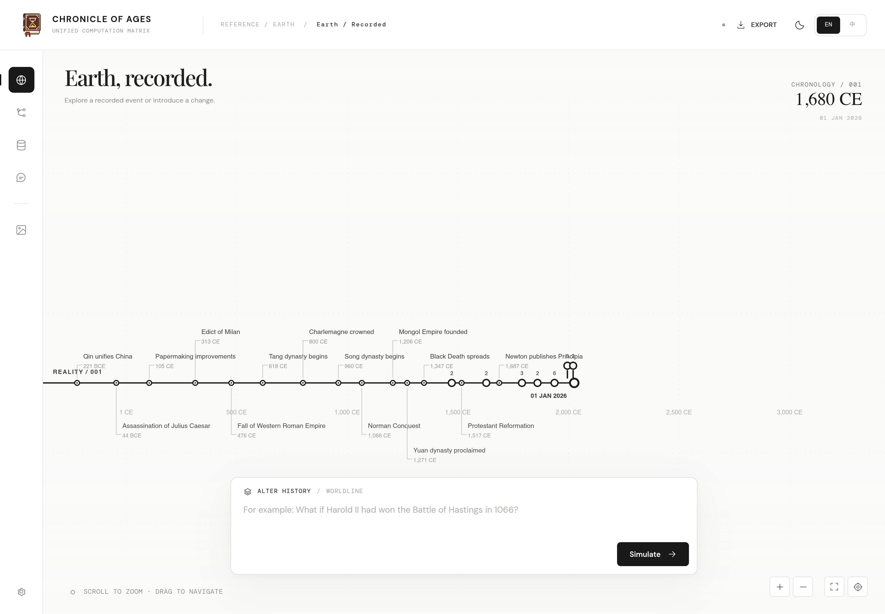
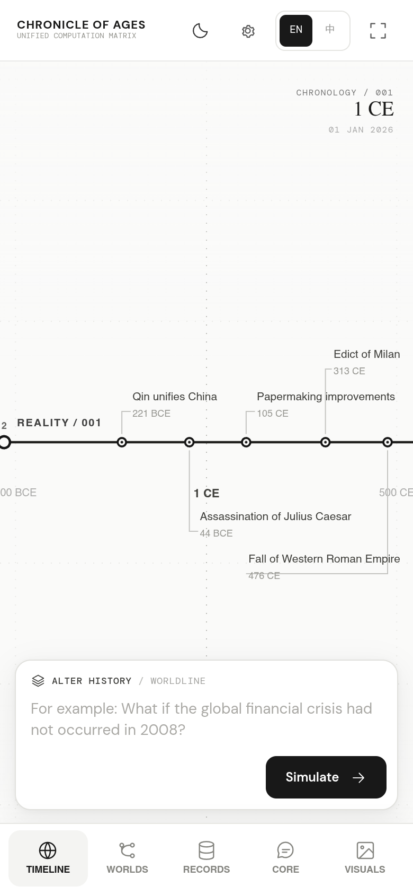

<div align="center">
  

  # CHRONICLE OF AGES

  **UNIFIED COMPUTATION MATRIX**

  Earth history · Divergent worldlines · Causal simulation

  [Open web application](https://cha290196-hue.github.io/Chronicle-of-Ages/) · [Source code](https://github.com/cha290196-hue/Chronicle-of-Ages) · [Report an issue](https://github.com/cha290196-hue/Chronicle-of-Ages/issues)

  <a href="README.md"><b>English</b></a> &nbsp; · &nbsp; <a href="README.zh-CN.md"><b>简体中文</b></a>

  <sub>BROWSER APPLICATION</sub>
</div>

---

<div align="center">
  
  <br />
  <sub>CHRONOLOGY / DESKTOP WORKSPACE</sub>
</div>

<details>
<summary>Mobile interface</summary>
<br />
<div align="center"></div>
</details>

<p align="center">
  <a href="#a-turning-point-another-history">Overview</a> &nbsp; / &nbsp;
  <a href="#the-workspace">Features</a> &nbsp; / &nbsp;
  <a href="#start-exploring">Quick start</a> &nbsp; / &nbsp;
  <a href="#your-worlds-your-connection">Data &amp; API</a> &nbsp; / &nbsp;
  <a href="#run-it-locally">Development</a>
</p>

## A turning point, another history

Explore Earth's recorded history, introduce a change and follow the world that develops from it. Each worldline shares its past with its parent, then takes its own course from the chosen turning point.

**Chronicle of Ages** brings that history, its people, institutions and technologies into one workspace. Move between worldlines, inspect their events and ask the Core to develop the details.

<sub>EARTH HISTORY &nbsp; · &nbsp; c. 3200 BCE — 1 JANUARY 2026 &nbsp; · &nbsp; ENGLISH / 简体中文</sub>

## The workspace

<table>
<tr>
<td width="50%" valign="top">
<sub>01 / CHRONOLOGY</sub>
<h3>Read history on a canvas</h3>
<p>Pan through time, zoom into a period and open individual events. The recorded timeline remains the common starting point.</p>
</td>
<td width="50%" valign="top">
<sub>02 / WORLDLINES</sub>
<h3>Give history another course</h3>
<p>Describe a change to create a worldline. Continue from an existing branch while retaining its shared past.</p>
</td>
</tr>
<tr>
<td width="50%" valign="top">
<sub>03 / THE CORE</sub>
<h3>Ask about the world</h3>
<p>Explore daily life, institutions, technology or a specific detail. The model answers in the selected world's context and can record new settings.</p>
</td>
<td width="50%" valign="top">
<sub>04 / WORLD DATABASE</sub>
<h3>Keep the details together</h3>
<p>Browse and search events and knowledge. Add, edit or remove records within the world they belong to.</p>
</td>
</tr>
<tr>
<td width="50%" valign="top">
<sub>05 / CONTINUITY</sub>
<h3>Pick up where you stopped</h3>
<p>Return to your viewport, selected world and drafts in the same browser. Export worlds as JSON to keep a separate backup.</p>
</td>
<td width="50%" valign="top">
<sub>06 / WORLD IMAGES</sub>
<h3>Picture the setting</h3>
<p>Connect an image service to illustrate a world. Text and image services have independent model and key settings.</p>
</td>
</tr>
</table>

## Start exploring

**[Open Chronicle of Ages →](https://cha290196-hue.github.io/Chronicle-of-Ages/)**

| Step | What to do |
| :--- | :--- |
| **01 · Connect** | Open **Settings**, select **Text only**, then choose **DeepSeek Flash** or configure an OpenAI-compatible endpoint. Enter your own API key and save. |
| **02 · Create** | Enter a historical change and select **Simulate**. The model fills in missing context and decides how far to develop the account. |
| **03 · Explore** | Select a worldline's endpoint, inspect its events and ask questions in **The Core**. |

The recorded timeline is available before connecting a model. Text configuration is sufficient for generation and questions; image generation is optional.

<details>
<summary><b>Model connection options</b></summary>

<br />

| Connection | Configuration |
| :--- | :--- |
| **DeepSeek** | The **DeepSeek Flash** shortcut fills the official text endpoint and model. Supply your own key. |
| **OpenAI / OpenRouter / custom** | Set the endpoint, model ID and key for a compatible chat-completions service. |
| **Images** | Enable **Images only** or **Text + images** and configure the image endpoint, model and key separately. Creating a new world still requires text generation. |

Requests go directly to the selected service. It must support browser requests through CORS, or be accessed through a suitable authenticated proxy.

</details>

## Navigate the timeline

| Action | Control |
| :--- | :--- |
| Move through time | Drag the canvas |
| Look closer | Scroll, use a trackpad or select **+ / −** |
| Read an event | Select its node |
| Choose a worldline | Select its branch endpoint |
| Continue a world | Select it, then enter another historical change |
| Explore its details | Open **The Core** and ask a question |
| Keep or restore a backup | Export or import a JSON archive |

## Your worlds, your connection

| Item | How it works |
| :--- | :--- |
| **Worlds and conversations** | Stored in this browser. Other visitors have their own data. |
| **API keys** | Supplied by each visitor; no shared project key is included. Keys are session-only unless **Remember** is enabled. |
| **Model usage** | Requests use the configured key. The model provider applies its own pricing and limits. |
| **Saved workspace** | Restores your selected world, camera, panels and drafts when you return in the same browser. |
| **Moving devices** | Export and import a backup. There is no account-based cross-device sync. |

Generation sends the input and relevant world context to the configured model service. Local storage is scoped to the browser profile: people sharing that profile also share its saved state. Export a backup before clearing site data.

<details>
<summary><b>How generation works</b></summary>

<br />

The model interprets the premise, completes missing context and develops the world's history. It chooses the number of events and amount of text. Core questions use the selected world and conversation to answer and expand its settings.

The application handles the timeline, record format, storage and API transport. Progress responds to actual model output. There is no application inference deadline; incomplete or interrupted output is reported instead of saved as a finished world.

The reference chronology contains selected milestones. Generated worlds are alternate-history scenarios. All worldlines end on **1 January 2026**.

[Read the engine documentation →](docs/ENGINE.md)

</details>

## Run it locally

Serve the repository with **Python 3**. No package installation or frontend build is required.

```bash
git clone https://github.com/cha290196-hue/Chronicle-of-Ages.git
cd Chronicle-of-Ages
python3 -m http.server 8080
```

Open **[localhost:8080](http://localhost:8080)** and configure a model in Settings.

<details>
<summary><b>Development, tests and deployment</b></summary>

<br />

Use **Node.js 20+** to run the automated tests:

```bash
npm test                 # current application + archived regressions
npm run test:current     # current application
npm run test:archive     # retired engines and historical replays
```

The application uses JavaScript ES modules, Canvas 2D and browser storage. The included GitHub Actions workflow tests the project and publishes a versioned static artifact to GitHub Pages. Historical engine code and evaluation data are excluded from that artifact.

| Documentation | Contents |
| :--- | :--- |
| [Engine](docs/ENGINE.md) | Generation, streaming, failure handling and storage compatibility |
| [Development](docs/DEVELOPMENT.md) | Repository layout, verification and deployment |
| [Archive](archive/README.md) | Retired engines, response replays and original source snapshots |

</details>

---

<p align="center">
  <a href="LICENSE">MIT License</a> &nbsp; · &nbsp;
  <a href="https://github.com/cha290196-hue/Chronicle-of-Ages/issues">Report an issue</a> &nbsp; · &nbsp;
  <a href="README.zh-CN.md">简体中文</a>
</p>
<p align="center"><sub>CHRONICLE OF AGES &nbsp; / &nbsp; UNIFIED COMPUTATION MATRIX</sub></p>
