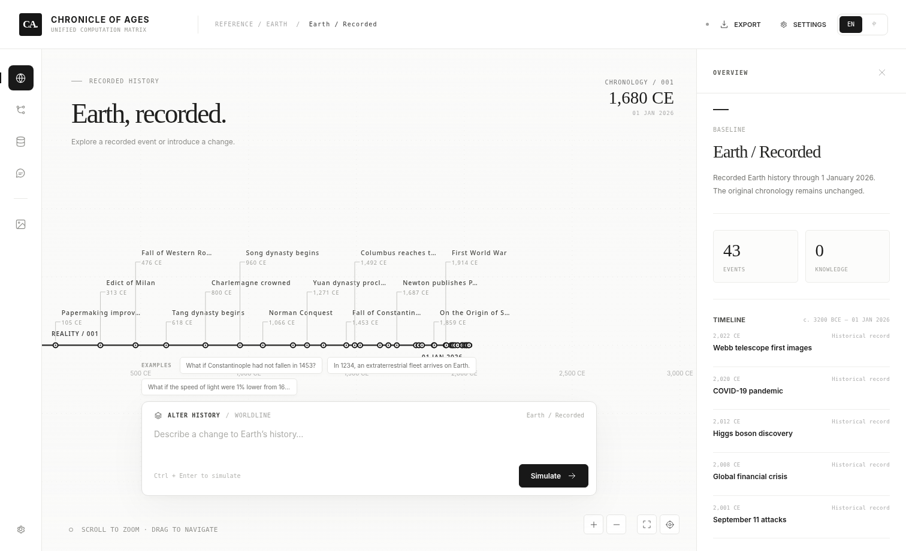
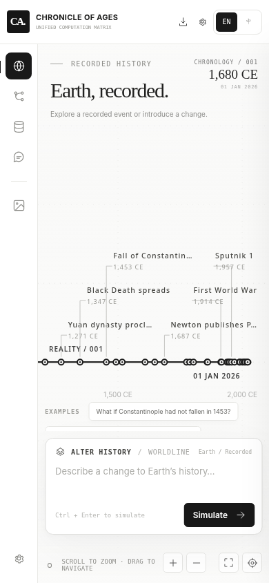

<div align="center">
  

  # 岁月史书

  **统合演算矩阵**

  地球历史 · 分支世界线 · 因果推演

  [打开网页版](https://cha290196-hue.github.io/Chronicle-of-Ages/) · [查看源码](https://github.com/cha290196-hue/Chronicle-of-Ages) · [反馈问题](https://github.com/cha290196-hue/Chronicle-of-Ages/issues)

  <a href="README.md"><b>English</b></a> &nbsp; · &nbsp; <a href="README.zh-CN.md"><b>简体中文</b></a>

  <sub>仅提供网页版本 · 支持英文与简体中文</sub>
</div>

---

<div align="center">
  
  <sub>时间线 / 桌面版</sub>
</div>

<details>
<summary>查看手机端界面</summary>
<br />
<div align="center"></div>
</details>

## 项目简介

岁月史书是一套在浏览器中运行的地球历史时间线与分支世界线推演系统。现实世界的历史基线保持不变，用户可以输入带有历史时间锚点的修改，系统使用已连接的文本大模型按时间段推演后续变化，创建新的世界线，并把衍生事件、技术、人物和概念保存到该世界线的知识库中。

现实基线覆盖**约公元前 3200 年至 2026 年 1 月 1 日**。当前显示的是经过筛选的历史里程碑，用于导航与启发，不代表完整收录全部人类史料。

## 主要功能

| 模块 | 功能 |
| :--- | :--- |
| **历史时间线** | 在可缩放、可拖拽的画布中浏览既有史事和分叉世界线。 |
| **世界线演算** | 校验地球历史锚点，按年代分段传播因果影响，再统一整理世界状态。 |
| **世界数据库** | 查看、搜索、新增、修改或删除衍生历史事件与知识。 |
| **演算中枢** | 基于选定世界线的事件与知识记录，向文本模型提问。 |
| **世界图像** | 可选地连接独立生图服务，生成当前世界的场景图像。 |
| **本地存档** | 在浏览器中保留多条分支，支持 JSON 格式导入与导出。 |
| **语言** | 仅支持英语与简体中文，可在网页顶部直接切换。 |

### 世界线规则

- 原始世界限定为地球：允许修改已记录的地球历史、真实物理常数，或者在明确的地球年份引入外来事件（例如公元 1234 年外星人抵达地球）。
- 不允许把没有地球历史锚点的虚构外星文明或未知星球当作既有历史事实进行修改。
- 新世界线推演出来的技术、机构、人物与其他新知识，会进入该分支及其后代分支可继续操作的数据库。
- 每条世界线独立保存；修改新分支不会覆盖原始世界的历史基线。
- 系统区分历史记载和模型推演生成的情境。推演结果并不等于历史事实。
- 时间跨度止于 **2026 年 1 月 1 日**。

## 演算流程

```text
现实地球历史基线
      │
      ▼
历史修改与锚点校验
      │
      ▼
建立分叉前的世界状态
  · 历史记录
  · 上游分支知识
      │
      ▼
按年代检查点传播因果影响
  · 历史事件账本
  · 新实体与技术
  · 因果关系
      │
      ▼
整理世界线状态与不确定性
      │
      ▼
可编辑的分支世界数据库
      │
      ├── 从当前分支继续修改
      ├── 在演算中枢提问
      └── 可选的世界图像生成
```

每个阶段都会读取当前修改、相关历史、分叉前继承的知识以及已生成的时间线状态，并对输出记录进行结构校验。新世界线中的记录保存后，可作为下一次推演的输入。

## 在线使用与本地运行

**网页版：** https://cha290196-hue.github.io/Chronicle-of-Ages/

本项目是静态网页，不要求安装后端，也不需要构建步骤。

```bash
git clone https://github.com/cha290196-hue/Chronicle-of-Ages.git
cd Chronicle-of-Ages
python3 -m http.server 8080
```

随后打开 `http://localhost:8080`。

## API 配置

在网页右上角打开 **Settings（设置）**，选择 API 类型：

| 模式 | 需要配置 | 可以做什么 |
| :--- | :--- | :--- |
| **仅文本** | 文本服务商、接口、模型、API 密钥 | 推演新世界线、演算中枢问答。**无需配置图片模型。** |
| **仅生图** | 生图服务商、接口、模型、独立 API 密钥 | 为已有分支生成图像；若要从现实基线创建新世界线，仍需先启用文本模型。 |
| **文本 + 生图** | 两套相互独立的配置 | 同时使用推演、问答和生图功能。 |

### DeepSeek 一键快捷配置

1. 在 **设置 → 仅文本**（或“文本 + 生图”）中，点击 **DeepSeek Flash** 或 **DeepSeek V4 Pro**。
2. 程序会自动填入 DeepSeek 的官方接口和模型 ID：

   | 快捷模式 | 模型 ID |
   | :--- | :--- |
   | DeepSeek Flash | `deepseek-flash` |
   | DeepSeek V4 Pro | `deepseek-v4-pro` |

   API 地址会自动设置为 `https://api.deepseek.com/chat/completions`。
3. 在文本 API 密钥框中输入自己申请的 DeepSeek 密钥，点击 **保存**；可使用“测试连接”检查文本接口。
4. 返回主界面，输入历史修改即可开始推演；**不需要填写任何生图配置**。

DeepSeek 在这里作为**文本模型服务商**。如果需要生成图片，切换到“文本 + 生图”，再单独配置 OpenAI、OpenRouter 或自定义兼容生图接口。修改文本模型不会覆盖已有的图片设置。

### 密钥与连接

文本 API 密钥和生图 API 密钥分别保存。默认密钥仅保留在浏览器当前会话；若勾选“在本设备记住 API 密钥”，会保存在当前浏览器的本地存储中。项目不内置任何服务商密钥。

网页直接向用户填写的 API 地址发送请求；所选服务商需要允许浏览器跨域调用（CORS）。如果该服务商不允许浏览器访问，则需要自建具备鉴权和访问限制的代理，不能仅靠修改前端设置解决。

## 操作说明

| 操作 | 方式 |
| :--- | :--- |
| 移动时间线 | 在画布上按住并拖动 |
| 缩放 | 滚轮或触控板缩放，也可以点击 ± |
| 查看历史节点 | 点击节点打开事件详情 |
| 查看完整历史 | 使用时间线适配按钮 |
| 创建分支 | 输入历史修改并开始推演 |
| 继续推演 | 选择现有世界线，再输入新的历史修改 |
| 询问世界情况 | 打开“演算中枢” |
| 导出存档 | 导出 JSON 文件 |
| 恢复存档 | 导入 JSON 文件 |

世界线数据保存在当前浏览器中。清理浏览器站点数据或更换设备前，建议先导出存档。

## 技术结构

| 部分 | 使用技术 |
| :--- | :--- |
| 界面 | HTML、CSS、JavaScript ES Modules |
| 时间线 | Canvas 2D、指针交互、缩放和平移 |
| 推演引擎 | LLM Chat Completions、结构化 JSON、分段状态传递 |
| 数据 | 精选基线史事、分支事件和概念记录 |
| 存储 | localStorage、JSON 存档 |
| 部署 | GitHub Pages、GitHub Actions |
| 测试 | Node.js 内置测试运行器 |

在仓库目录运行测试：

```bash
npm test
```

### 技术参考

- [Generative Agents: Interactive Simulacra of Human Behavior](https://doi.org/10.1145/3586183.3606763) — 记忆、计划与反思。
- [vis-timeline](https://github.com/visjs/vis-timeline) — 时间线缩放与拖拽交互。
- [OpenAI Structured Outputs](https://developers.openai.com/api/docs/guides/structured-outputs) — 结构化模型输出。
- [DeepSeek API 官方文档](https://api-docs.deepseek.com/zh-cn/) — 最新模型名称、聊天接口及 JSON 输出。
- [GitHub Pages 官方工作流文档](https://docs.github.com/en/pages/getting-started-with-github-pages/using-custom-workflows-with-github-pages) — 静态网站部署。

---

<div align="center"><sub>岁月史书 / 统合演算矩阵</sub></div>