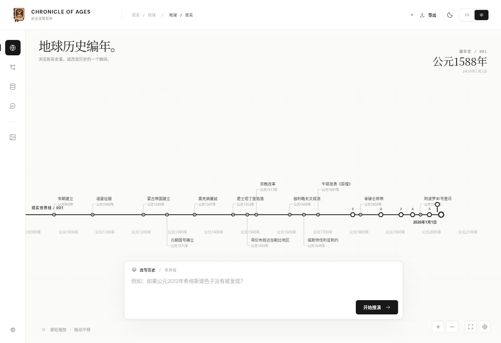
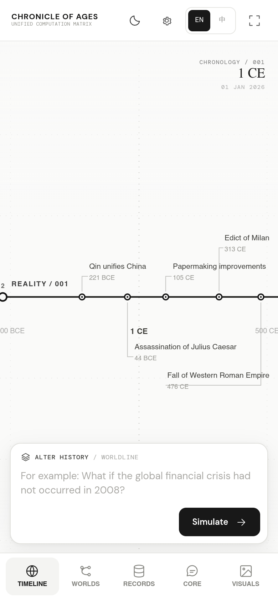

<div align="center">
  

  # 岁月史书

  **统合演算矩阵**

  地球历史 · 分支世界线 · 因果推演

  [打开网页版](https://cha290196-hue.github.io/Chronicle-of-Ages/) · [查看源码](https://github.com/cha290196-hue/Chronicle-of-Ages) · [反馈问题](https://github.com/cha290196-hue/Chronicle-of-Ages/issues)

  <a href="README.md"><b>English</b></a> &nbsp; · &nbsp; <a href="README.zh-CN.md"><b>简体中文</b></a>

  <sub>仅提供网页版本 · 支持英文与简体中文</sub>
</div>

---

<div align="center">
  
  <sub>时间线 / 桌面版</sub>
</div>

<details>
<summary>查看手机端界面</summary>
<br />
<div align="center"></div>
</details>

<p align="center">
  <a href="#从一个转折点展开另一段历史">项目简介</a> &nbsp; / &nbsp;
  <a href="#在一张画布里探索世界">核心功能</a> &nbsp; / &nbsp;
  <a href="#开始探索">快速上手</a> &nbsp; / &nbsp;
  <a href="#自己的世界自己的连接">数据与接口</a> &nbsp; / &nbsp;
  <a href="#在本地运行">本地运行</a>
</p>

## 从一个转折点，展开另一段历史

浏览地球已经发生的历史，改变其中一个条件，沿着分叉走进另一个世界。每条世界线与父线共享分叉之前的过去，再从转折点继续展开。

**岁月史书**把这段历史，以及其中的人物、制度与技术，放进同一个工作区。你可以切换世界线、查看事件，也可以向演算中枢追问这个世界的细节。

<sub>地球历史 &nbsp; · &nbsp; 约公元前 3200 年 — 2026 年 1 月 1 日 &nbsp; · &nbsp; 简体中文 / ENGLISH</sub>

## 在一张画布里探索世界

<table>
<tr>
<td width="50%" valign="top">
<sub>01 / 历史时间线</sub>
<h3>在时间中移动</h3>
<p>拖动画布浏览历史，放大到某个时期，打开节点阅读事件。现实历史始终保留为共同起点。</p>
</td>
<td width="50%" valign="top">
<sub>02 / 分支世界线</sub>
<h3>让历史走向另一条路</h3>
<p>输入一次改变，创建新的世界线。也可以从已有分支继续推演，保留分叉之前共享的过去。</p>
</td>
</tr>
<tr>
<td width="50%" valign="top">
<sub>03 / 演算中枢</sub>
<h3>追问这个世界的细节</h3>
<p>从日常生活到制度、技术或某个具体参数，在选定世界的背景下提问。模型回答问题，并可保存补全的新设定。</p>
</td>
<td width="50%" valign="top">
<sub>04 / 世界数据库</sub>
<h3>把事件与知识留在世界里</h3>
<p>浏览、检索事件与知识记录，在对应世界中新增、编辑或删除内容，逐步补全它的面貌。</p>
</td>
</tr>
<tr>
<td width="50%" valign="top">
<sub>05 / 状态恢复</sub>
<h3>接着上次的位置继续</h3>
<p>在同一浏览器重新打开，恢复视角、选中的世界和草稿。也可以导出 JSON，单独保存一份备份。</p>
</td>
<td width="50%" valign="top">
<sub>06 / 世界图像</sub>
<h3>为世界留下一个画面</h3>
<p>连接生图服务，描绘当前世界的场景。文本与生图分别配置模型、接口和密钥。</p>
</td>
</tr>
</table>

## 开始探索

**[打开岁月史书 →](https://cha290196-hue.github.io/Chronicle-of-Ages/)**

| 步骤 | 操作 |
| :--- | :--- |
| **01 · 连接模型** | 打开**设置**，选择**仅文本**，点击 **DeepSeek Flash**，或填写其他兼容接口。输入自己的 API 密钥并保存。 |
| **02 · 创建世界** | 输入一次历史改变，点击**开始推演**。缺少的背景由模型补足，事件数量和展开篇幅由模型决定。 |
| **03 · 探索细节** | 点击世界线的**分叉末端**选中它，查看事件，再到**演算中枢**继续提问。 |

未配置模型时也能浏览现实时间线。推演和问答只需文本配置，生图功能按需开启。

<details>
<summary><b>支持哪些模型连接？</b></summary>

<br />

| 连接方式 | 配置方法 |
| :--- | :--- |
| **DeepSeek** | **DeepSeek Flash** 快捷配置会填入官方文本接口和模型，自行填写密钥即可。 |
| **OpenAI / OpenRouter / 自定义** | 填写兼容 Chat Completions 的接口地址、模型 ID 与密钥。 |
| **生图** | 选择**仅生图**或**文本 + 生图**，单独填写生图接口、模型和密钥。创建新的世界线仍需文本模型。 |

请求由浏览器直接发往所选服务。服务商需允许跨域调用（CORS），或通过合适的鉴权代理访问。

</details>

## 在时间线上操作

| 操作 | 方式 |
| :--- | :--- |
| 移动时间线 | 按住画布拖动 |
| 查看更近的历史 | 滚轮、触控板，或点击 **+ / −** |
| 阅读事件 | 点击事件节点 |
| 选中世界线 | 点击对应分支的末端 |
| 继续创建分支 | 选中世界，再输入新的历史改变 |
| 追问世界细节 | 打开**演算中枢**并提问 |
| 备份与恢复 | 导出或导入 JSON 存档 |

## 自己的世界，自己的连接

| 内容 | 保存或使用方式 |
| :--- | :--- |
| **世界线与聊天记录** | 保存在当前浏览器，不与其他访问者共享。 |
| **API 密钥** | 每位访问者自行填写，项目不内置共用密钥；默认仅在会话中保存，勾选“记住”后保留在本地。 |
| **模型用量** | 使用当前配置的密钥，由对应服务商计费并执行额度限制。 |
| **工作区状态** | 在同一浏览器恢复选中的世界、视角、面板和草稿。 |
| **更换设备** | 导出后在另一台设备导入，不提供账号式跨设备同步。 |

推演时，输入和相关世界内容会发送给所配置的模型服务商。本地存档按浏览器配置区分；共用同一浏览器配置的人，也会共用其中的状态。清理站点数据前，请先导出备份。

<details>
<summary><b>推演如何进行？</b></summary>

<br />

模型理解设想、补全必要背景，生成这个世界的历史，自行决定事件数量和正文篇幅。演算中枢结合选中的世界与对话回答问题，并补充需要保存的新设定。

程序负责时间线、数据格式、存储与接口通信。进度条随模型实际返回移动，推演没有应用层时间限制；未完成或中断的结果会提示错误，不会被保存成完整世界。

现实时间线收录经过筛选的历史里程碑；生成的世界属于历史推演情境。所有世界线的终点均为 **2026 年 1 月 1 日**。

[查看引擎文档 →](docs/ENGINE.md)

</details>

## 在本地运行

使用 **Python 3** 启动静态服务，无需安装依赖或构建前端。

```bash
git clone https://github.com/cha290196-hue/Chronicle-of-Ages.git
cd Chronicle-of-Ages
python3 -m http.server 8080
```

打开 **[localhost:8080](http://localhost:8080)**，在设置中配置模型即可使用。

<details>
<summary><b>开发、测试与部署</b></summary>

<br />

使用 **Node.js 20+** 运行自动测试：

```bash
npm test                 # 当前应用及历史回归测试
npm run test:current     # 当前应用
npm run test:archive     # 旧引擎及历史数据回放
```

项目使用 JavaScript ES Modules、Canvas 2D 与浏览器存储。仓库自带的 GitHub Actions 工作流会执行测试，再将带版本标识的静态产物部署至 GitHub Pages。历史引擎和评测材料不进入网页发布产物。

| 文档 | 内容 |
| :--- | :--- |
| [引擎说明](docs/ENGINE.md) | 推演、流式通信、异常处理和存档兼容 |
| [开发文档](docs/DEVELOPMENT.md) | 目录结构、验证方式与部署 |
| [历史归档](archive/README.md) | 旧引擎、历史返回数据和原始源码快照 |

</details>

---

<p align="center">
  <a href="LICENSE">MIT 许可证</a> &nbsp; · &nbsp;
  <a href="https://github.com/cha290196-hue/Chronicle-of-Ages/issues">反馈问题</a> &nbsp; · &nbsp;
  <a href="README.md">English</a>
</p>
<p align="center"><sub>岁月史书 &nbsp; / &nbsp; 统合演算矩阵</sub></p>
