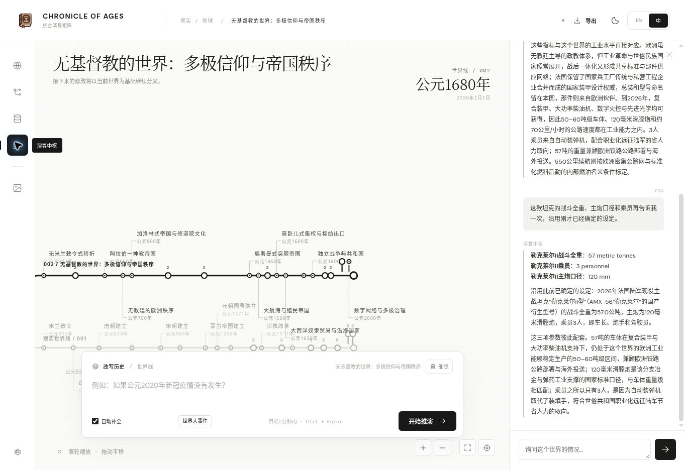

# Analysis Core: question-driven world completion

This change is confined to the Analysis Core, its branch-local knowledge records and the chat commit boundary. World creation, admission, timeline rendering, the dynamic output contract, model presets and the archived generator are unchanged.

## Behavior

A branch question resolves the necessary missing world details before answering. Initial snapshot entries labelled unknown or unresolved are unfilled slots; they do not prohibit subsequent derivation. Ordinary omitted dates and measurement conventions receive explicit defaults, reusing existing Core conventions. Annual measures distinguish the as-of snapshot from the accounting period. Entity granularity and units come from semantic planning, with no GDP keyword branch or fixed list of question topics.

The Core plans dependencies, derives concrete local settings, checks them, and answers from the accepted records. New world-local identities and measurements require mechanisms consistent with the branch. They are inferred canon for this conditional world, not externally observed statistics or a claim that counterfactual history has a unique scientific solution. Recorded Earth remains a real-history mode; hypothetical alterations remain nonpersistent.

Every request uses Flash on the official DeepSeek endpoint with thinking disabled. Core requests have their own output capacities and do not change world-creation budgets or output volume.

## Dependency and numerical checks

The same dependency pipeline handles identities, biographies, institutions, daily life, equipment specifications, arbitrary quantities and comparisons. Answer/support roles separate the requested result from intermediate premises. Typed requested parameters are rendered from approved records; numerical comparisons are likewise computed from approved data.

New atomic records can reference existing world evidence and other deductions in the same question. A topological admission pass resolves temporary proposal IDs, including forward references. Unknown sources, cycles, future evidence, incompatible existing values and invalid arithmetic are rejected. Optional product/sum/ratio calculations are checked against their quantitative operands and declared rounding. The former 28-candidate cap and long-description truncation are removed from Core knowledge admission.

Numerical comparisons cite quantitative records with the same metric, unit, accounting period and as-of year. The program sorts the accepted values, assigns ranks and renders the ordered list; the answer-writing model does not create another independent ranking. The ranking and its operands are stored together. Repeated questions can reuse the same ranking and numerical convention. Genuine inapplicability, such as a world without a human economy, can be explained directly; missing statistical records are not inapplicability.

Semantic review checks mechanisms, existing constraints and whether the requested details are actually resolved. A missing required dependency triggers one targeted field-patch completion of the same question-local transaction, retaining all sound prose and records. A hard contradiction fails without changing the world. The final answer receives approved records, not a rejected provisional draft. Only after the whole answer succeeds does the chat commit all discoveries; a late merge conflict or failed save cannot silently drop facts while presenting the answer as established.

## Storage and compatibility

Reviewed branch settings carry `commitment: world-canon`, `status: established-in-world`, their causal basis, assumptions and evidence. Structured quantities, calculations and rankings survive sanitization, archive export/import and descendant inheritance. Older hypothesis records remain readable. Core records do not replace the immutable initial history. Past-year questions receive only eligible prior snapshots and evidence.

## Validation

Contract tests cover concrete completion, default dates, same-question dependency chains, numerical arithmetic, ranking order, consistent repeated queries, mixed-metric rejection, immutable existing quantities, hypothetical isolation, recorded-Earth mode, archive round trips, bounded completion recovery and atomic chat commits. Mocked tests verify these mechanics rather than historical accuracy. Recorded provider tests are documented below after completion.

## Observed cloud-browser runs — 2026-11-09

The public Core entry (`exploreCore`) was called against the same saved Christianity-absence world, not a newly generated world. All stages used DeepSeek Flash; the supplied credential was entered only in a cloud-browser password field, cleared on start and excluded from records.

| Question | Complete elapsed | New records | Total stored | Archive round trip | Initial history |
| --- | ---: | ---: | ---: | --- | --- |
| French army vehicle identity, five parameters and industrial background | 39.74 s | 11 | 11 | Pass | Unchanged |
| Repeat the same vehicle's mass, calibre and crew | 11.77 s | 0 | 11 | Pass | Unchanged |
| Economic comparison in the same world, retaining the equipment records | 81.25 s | 42 | 53 | Pass | Unchanged |

The equipment response established a concrete identity and values. The follow-up reused the same 57-tonne mass, 120-mm calibre and three-person crew without creating duplicate facts. The comparative question completed its intermediate population/productivity and economic premises, corrected scale mismatches through field patches, sorted twelve entity values and stored the ranking with its operands. These are observed example runs, not proof of calibrated historical accuracy or exhaustive coverage of every possible natural-language question. Recorded provider-response replays also pass the current production contract and persistence checks.

Provider responses are in [the Core evaluation directory](evaluation/core/). Failed development prototypes remain under `failures/`: 23.41 s for unresolved references/empty proposals; 140.05 s for a full-rewrite completion that exhausted output capacity and exposed a harness retry-logging error; 37.41 s for incorrect unit scales; and 44.14 s when successful audit notes were mistakenly treated as blocking defects. They prompted data-first completion, compact evidence, field patches, numerical diagnostics, and separate blocking issues/notes. An additional comparative run was lost during the browser reset before its result was retrieved; it is unmeasured and is not counted as a success or a model failure.

