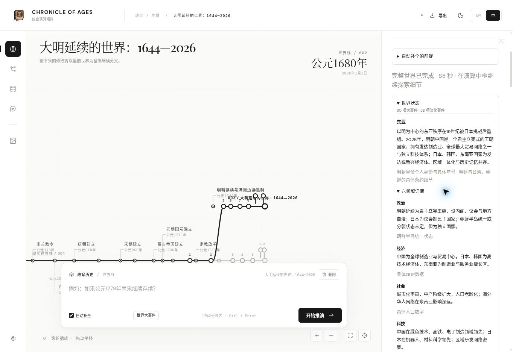

# Flash dynamic output evaluation — 2026-11-09

## Method

Requests use the production `core.simulate` entry from the cloud browser, the official DeepSeek endpoint, and **deepseek-flash for every stage**. The supplied credential is entered into a password field, cleared immediately on starting, and excluded from all saved evidence. No extra world is generated in parallel. The full 120-second deadline covers generation, conditional graph correction, independent audit, corrective audit and validation. Only a complete reviewed world counts as a success.

The output contract is dynamic-earth-v1: no event-count target, no 80-event ceiling, no prescribed single-event prose length. Every region has its own six domain settings. Transport capacities are separate from the content policy and do not request a particular word count. Input, trajectory, time, causal and persistence checks remain mandatory.

## Development failures

These are real failed development runs, not completed-world timing claims:

| Trial | Generation | Audit/other | Total | Failure |
| --- | ---: | ---: | ---: | --- |
| Christianity, initial dynamic protocol | 56.67 s | 18.38 s | 75.06 s | Audit JSON closed its object before edits; no complete correction available |
| Ming, full-record audit protocol | 68.96 s | 48.43 s | 117.40 s | Audit retransmitted a large world and retained a future cause |
| Christianity, field-patch protocol before registry fix | 66.09 s | 20.45 s | 86.56 s | Audit lacked explicit intervention definitions and incorrectly removed valid intervention roots |
| Christianity, registry supplied | 87.27 s | 32.73 s | 120.01 s | Full audit exceeded the shared deadline |
| Ming, before uncertainty classification | 51.04 s | 21.05 s | 72.09 s | Audit rejected conditional independent continuity instead of distinguishing uncertainty from hard contradiction |
| Christianity, dedicated audit controller | 78.20 s | 11.54 s | 89.75 s | Repeated future-cause patch failed mandatory validation |
| Christianity, final profile after browser recovery | 101.05 s | 18.93 s (aborted) | 120.01 s | Generation completed; independent audit reached the deadline, no world saved |
| Ming, stale regional index after causal correction | 75.07 s | 7.85 s | 82.92 s | All API calls returned, but the old autonomous-membership index contradicted the corrected DAG |

The engine now supplies the intervention registry to all repair/audit calls and patches only changed fields. Regional trajectory membership is recomputed from actual causal reachability after every patch. The [stale-index response sequence](evaluation/failures/ming-stale-index-20261109.json) now passes the production replay and persistence regression without deleting history; its original failed runtime is still listed as a failure, not relabeled a measured success. It does not silently shrink final-world prose to recover from these failures.

## Completed runs

Measured complete results are added only after successful full-horizon review, validation and export/import checks. Word counts include unique primary world text: event titles/descriptions, world title/overview, regional narratives, their domain accounts and uncertainty, and global domain settings. They count Chinese Han characters and exclude punctuation, English letters, JSON structure, duplicated language properties and repeated snapshot projections. Initial background and admission/audit prose are excluded from this primary-text count.

| Input | Full elapsed | Events | World milestones | Regional domains | Primary Han characters | Event descriptions |
| --- | ---: | ---: | ---: | ---: | ---: | ---: |
| Ming survival, dynamic-output pilot | 107.95 s | 64 | 22 | 42 | 8,076 | 3,848 |
| Ming survival, final profile with derived membership | **83.48 s** | **58** | **30** | **42** | **6,672** | **3,675** |

The Ming pilot used the same dynamic content policy, all-Flash routing and graph/coverage/persistence gates. It preceded the final phase-specific audit-controller prompt and focused chronology correction. Its generation took 57.51 s, graph correction 4.22 s and audit 46.18 s. The final controller avoids requesting another full world during auditing; chronology-only retries receive the affected records and explicit permitted/forbidden causes. The [recorded pilot responses](evaluation/flash-dynamic-ming-20261109.json) replay through the production graph and persistence code.

The [final-profile Ming run](evaluation/flash-dynamic-ming-final-20261109.json) completed all generation, graph correction, independent audit, validation and export/import checks. Generation took 76.11 s, graph correction 3.77 s and independent audit 3.55 s. All requests used Flash with thinking disabled. Content was selected dynamically: no event or prose target was changed between the pilot and final run. The principal text is approximately 2.87 times the earlier compressed Ming run, and event descriptions approximately 3.01 times. This comparison measures text volume, not quality equivalence.

A later long-horizon trial was interrupted by the browser workspace reset before its final result was retrieved; it is unmeasured and is not counted as success or a model failure. The [final-profile Christianity timeout](evaluation/failures/christianity-final-timeout-20261109.json) is recorded with its completed generation and aborted audit; it is not counted as a completed world. Two-minute completion is therefore a target, not a demonstrated reliable bound for every input. One subsequent Ming request failed with a browser fetch error after 1.06 s without an HTTP response; a single fresh retry followed. That transport failure is not a measured generation time.

## Comparison limits

The earlier [compressed-profile measurements](MINUTE-EVALUATION.md) used a different content policy and a different audit model. Their primary-text totals were 3,347 Han characters for Christianity absence and 2,321 for Ming survival, with 2,056 and 1,219 in event descriptions. Those old successful times are not a latency guarantee for the expanded Flash-only profile. The frozen original v2 engine never completed the earlier full-world trial; no completed v2 word-count or quality equivalence can be claimed.

These are model-based conditional histories. More text and successful graph validation are not proof of historical accuracy. Provider load, output length and the complexity of necessary corrections affect completion time; failures and timeouts are retained rather than counted as fast successes.

## UI verification

The updated interface exposes each region’s six domain accounts and non-blocking assumptions/uncertainty. Flash is the sole DeepSeek shortcut; legacy Pro text profiles migrate to Flash. The production snapshot below uses recorded API output for UI verification, not another latency test.

